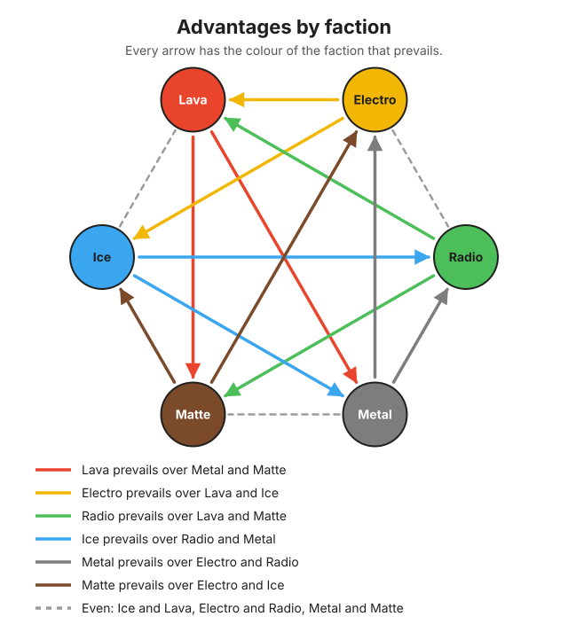
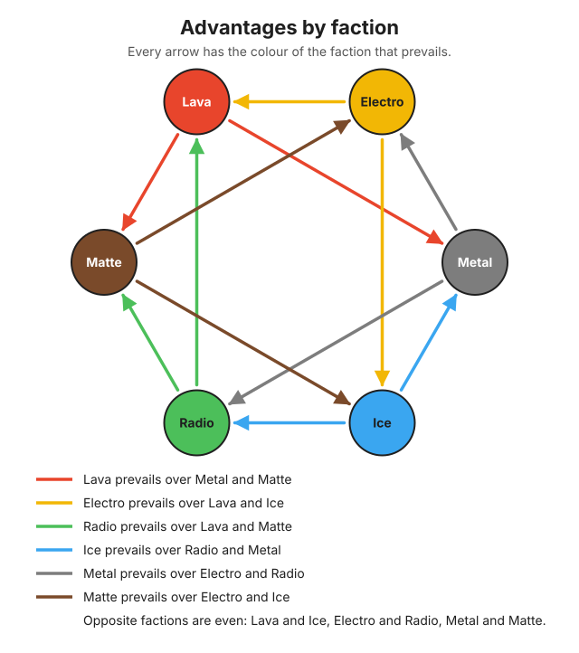
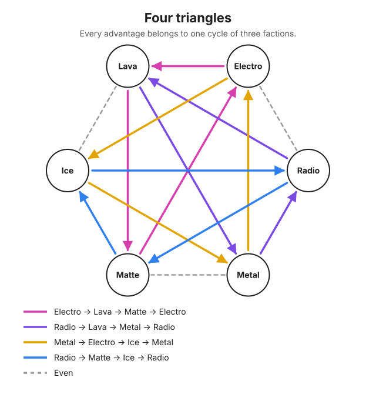
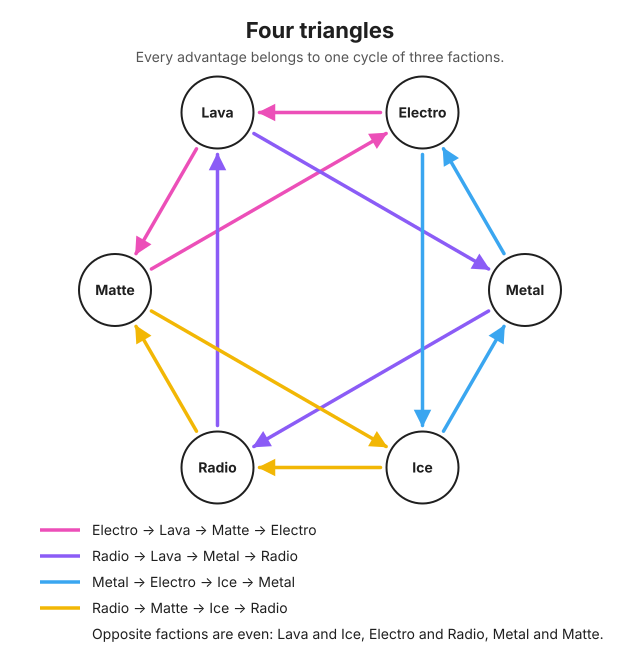
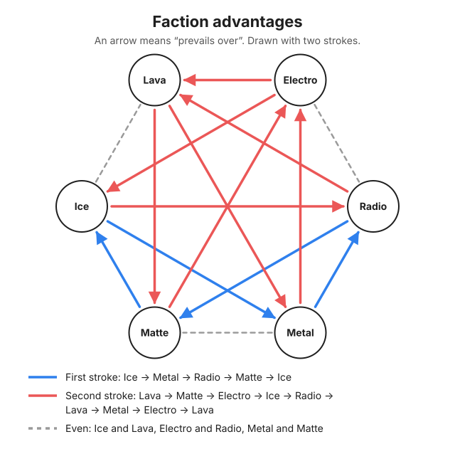

# Factions

Every creature belongs to a faction: the element it is made of. Six factions are elemental and give advantages to each other; two are inert and never give or receive any. Factions differ only in their advantages, never in their statistics.

## Elemental factions

| Faction | Worlds |
| --- | --- |
| Lava | Planets close to the stars, covered in magma. |
| Electro | Planets of conductive materials, wrapped in strong electromagnetic fields. |
| Radio | Planets of heavy, unstable elements, subject to radioactive decay. |
| Ice | Planets and comets far from the stars, where water and other common substances exist only as ice or freezing liquid. |
| Metal | Metallic planets, often strongly magnetic. |
| Matte | Dark planets of rock and chalky minerals: opaque, non-metallic, insulating. |

## Inert factions

| Faction | Origin | Rarity |
| --- | --- | --- |
| Gem | Crystals formed in the core of planets. | Every Gem card is an Elect card, and every Elect card is a Gem card. |
| Noble Gas | Creatures born in nebulae and between galaxies. | Every Noble Gas card is a Wanderer card, and every Wanderer card is a Noble Gas card. |

## Rules

- **FAC-01** Every elemental faction prevails over two factions, is overpowered by two factions and is even with one.
- **FAC-02** When a creature faces a creature of a faction it prevails over, it gets an ATK bonus (`ADVANTAGE_VALUE`) for the whole clash. The overpowered creature gets no modifier.
- **FAC-03** Every advantage is of the same kind: a bonus to the ATK of the creature that prevails. No advantage lowers the ATK of the opponent.
- **FAC-04** Two creatures of even factions, or of the same faction, clash with no modifier.
- **FAC-05** An inert faction (Gem, Noble Gas) never gives or receives an advantage, against any faction, inert or elemental.
- **FAC-06** The effective ATK is set when two creatures meet and stays the same for every round of their clash. A creature that survives and meets a new opponent gets its effective ATK set again against that opponent.
- **FAC-07** Advantages never change DEF. DEF goes down only with the damage taken.
- **FAC-08** No faction has a statistical profile. The cards of every faction follow the same distribution of ATK and DEF, rarity by rarity (see [cards-and-rarities.md](cards-and-rarities.md)).

How the effective ATK turns into damage and Energy is in [match.md](match.md).

## The twelve advantages

| Prevails | Over | Reason |
| --- | --- | --- |
| Lava | Metal | Lava melts metal. |
| Lava | Matte | Lava melts the rock. |
| Electro | Lava | Lava conducts: the discharge runs through it. |
| Electro | Ice | Ice conducts: the creature is struck by the discharge. |
| Radio | Lava | Heat doesn't stop decay: radiation passes through lava. |
| Radio | Matte | Radiation makes opaque matter decay from within. |
| Ice | Radio | Water is one of the best shields against radiation. |
| Ice | Metal | Frost makes metal brittle and jams its gears. |
| Metal | Electro | Metal conducts the energy and discharges the excess. |
| Metal | Radio | Metal armour shields radiation. |
| Matte | Electro | Rock insulates: the discharge finds no path and is lost. |
| Matte | Ice | Dark surfaces absorb heat and melt ice. |

## Matrix

Read the row as your creature and the column as the opposing one.

| You ↓ / Opponent → | Lava | Electro | Radio | Ice | Metal | Matte | Gem | Noble Gas |
| --- | --- | --- | --- | --- | --- | --- | --- | --- |
| **Lava** | – | ▼ | ▼ | = | ▲ | ▲ | = | = |
| **Electro** | ▲ | – | = | ▲ | ▼ | ▼ | = | = |
| **Radio** | ▲ | = | – | ▼ | ▼ | ▲ | = | = |
| **Ice** | = | ▼ | ▲ | – | ▲ | ▼ | = | = |
| **Metal** | ▼ | ▲ | ▲ | ▼ | – | = | = | = |
| **Matte** | ▼ | ▲ | ▼ | ▲ | = | – | = | = |
| **Gem** | = | = | = | = | = | = | – | = |
| **Noble Gas** | = | = | = | = | = | = | = | – |

- ▲ You prevail: your creature gets the ATK bonus.
- ▼ You are overpowered: the opposing creature gets the ATK bonus.
- = Even: no modifier.
- – Same faction: no modifier.

Every elemental row has two ▲, two ▼ and one =.

## Diagrams

An arrow means "prevails over". A dashed line joins two even factions.

## Rationale

- **Factions from the elements.** Each faction is the element its planet is made of, so its advantages follow from how the elements interact. The relations are easy to remember and keep the system far from long chains of types and combinations.
- **Every faction is worth the same.** Each one prevails over two, is overpowered by two and is even with one, so no faction is stronger than the others: what changes is against whom it is worth playing.
- **Only one kind of advantage.** In a clash both creatures hit at the same time, and only a creature that survives generates Energy. A bonus that lowered the opponent's ATK would decide which creature survives far more often than a bonus to one's own ATK, so the factions holding it would be stronger. With a single kind of advantage every faction stays equal. The reasons of Ice, Metal and Matte describe shields and insulation: in the lore they protect, in the game their effect is the same bonus as every other faction.
- **No statistical profile per faction.** If some factions had more ATK and others more DEF, the advantages would weigh differently for each of them and the balance would depend on both. With the same distribution for every faction, the identity of a faction comes from its advantages and its lore, and every card can take any split of ATK and DEF.
- **Inert factions.** Gem and Noble Gas, like noble gases in chemistry, do not react with any element. Their strength is in their higher rarity, not in advantages, and no faction can counter them.